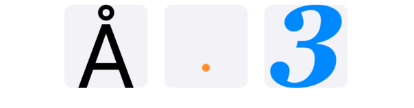
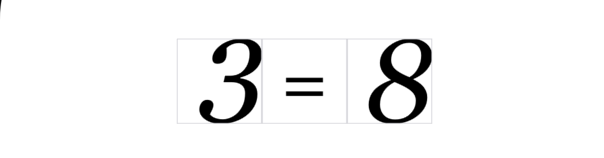

# GlyphKit

Render any font glyph into a SwiftUI view with point-precise sizing — tight to the path or baseline-aligned.


## Features

**Core**
- Extracts vector glyph outlines via Core Text — no UILabel, no text rendering pipeline
- No baseline shifts, no Dynamic Type interference

**Sizing**
- Tight — glyph fills the container edge to edge, regardless of font metrics
- Typographic — preserves visual weight within the font's vertical metrics

**Placement**
- Point-precise control over glyph bounds
- Anchor and offset for fine-grained positioning

**Styling**
- `GlyphShape` is a SwiftUI `Shape` — stroke, gradient fill, trim, or clip any view to a glyph

**Use cases**
- Grid-based layouts: notebook-style arithmetic UI, symbol displays

## Requirements

- iOS 17+
- Swift 6

## Installation

### Swift Package Manager

In Xcode: **File → Add Package Dependencies**

Enter the repository URL:
```
https://github.com/MaksimG82/GlyphKit
```

Or add directly to `Package.swift`:

```swift
dependencies: [
    .package(url: "https://github.com/MaksimG82/GlyphKit", from: "1.0.0")
]
```

## Quick Start


```swift
import GlyphKit

// Tight — glyph fills the frame completely
GlyphShape("Å")
    .fill(.primary)
    .frame(width: 80, height: 80)

// Typographic — preserves proportions within the font's vertical metrics
GlyphShape(".",
    layout: GlyphLayout(sizing: .fontMetrics, anchor: .center, offset: .zero)
)
.fill(.orange)
.frame(width: 80, height: 80)

// Custom font, custom color
GlyphShape("3",
    font: .system(.georgia, isBold: true, isItalic: true),
    layout: .default
)
.fill(.blue)
.frame(width: 80, height: 80)
```

## GlyphShape

`GlyphShape` is a SwiftUI `Shape`, so any shape modifier works on it:

```swift
// Outline
GlyphShape("A")
    .stroke(.blue, lineWidth: 2)

// Fill and stroke
GlyphShape("g")
    .fill(.yellow)
    .stroke(.orange, lineWidth: 3)

// Stroke kept entirely inside the frame (GlyphShape is an InsettableShape).
// Round joins stop sharp corners from poking out past the frame.
GlyphShape("W")
    .strokeBorder(.green, style: StrokeStyle(lineWidth: 10, lineJoin: .round))
    .frame(width: 80, height: 80)

// Gradient fill
GlyphShape("G", font: .system(.futura, isBold: true))
    .fill(LinearGradient(colors: [.purple, .pink], startPoint: .top, endPoint: .bottom))

// Clip any content to a glyph
HStack(spacing: 0) {
    ForEach([Color.red, .orange, .yellow, .green, .blue, .purple], id: \.self) { $0 }
}
.clipShape(GlyphShape("R", font: .system(.americanTypewriter, isBold: true)))

// Draw the outline progressively
GlyphShape("S", font: .system(.georgia, isItalic: true))
    .trim(from: 0, to: progress)
    .stroke(.indigo, lineWidth: 2)
```

### Migrating from GlyphView

`GlyphView` is deprecated. Replace it with `GlyphShape` and move `color` into a fill:

```swift
// Before
GlyphView("A", font: font, layout: layout, color: .blue)

// After
GlyphShape("A", font: font, layout: layout)
    .fill(.blue)
```

## Sizing Modes

| Mode | Description |
|------|-------------|
| `.tight` | Glyph path fills the container exactly. Small symbols like `.` or `-` scale up to fill the frame. |
| `.fontMetrics` | Glyph is placed within the full ascent + descent range. Small symbols stay small, preserving their visual weight relative to other characters. |

## Use Case — Notebook Grid


GlyphKit is well suited for grid-based educational UIs where glyphs must sit precisely within fixed cells — for example, an arithmetic notebook where digits and operators are rendered into a ruled or squared grid:

```swift
    let items: [(Character, GlyphSizing)] = [
        ("3", .tight),
        ("=", .fontMetrics),
        ("8", .tight)
    ]
    
    HStack(spacing: 0) {
        ForEach(items, id: \.0) { digit, sizing in
            GlyphShape(digit,
                font: .system(.georgia, isItalic: true),
                layout: GlyphLayout(
                    sizing: sizing,
                    anchor: sizing == .tight ? .trailing : .center,
                    offset: .zero
                )
            )
            .fill(.primary)
            .frame(width: 56, height: 56)
            .border(Color(.systemGray4), width: 0.5)
        }
    }
    .padding()

```

## Limitations

GlyphKit renders the outline of a single glyph, so it supports characters that the chosen font maps to one glyph with a vector outline.

- **Characters outside the font.** If the font has no glyph for the character, nothing is drawn. There is no fallback to another font (for example, a CJK character in Georgia).
- **Color emoji.** Emoji are stored as bitmaps in their fonts and have no outline, so they are not drawn.
- **Empty glyphs.** Characters without an outline, such as a space or a zero-width character, draw nothing.

## Documentation

Full documentation is available at [MaksimG82.github.io/GlyphKit](https://MaksimG82.github.io/GlyphKit/documentation/glyphkit)

## License

GlyphKit is available under the MIT license.
